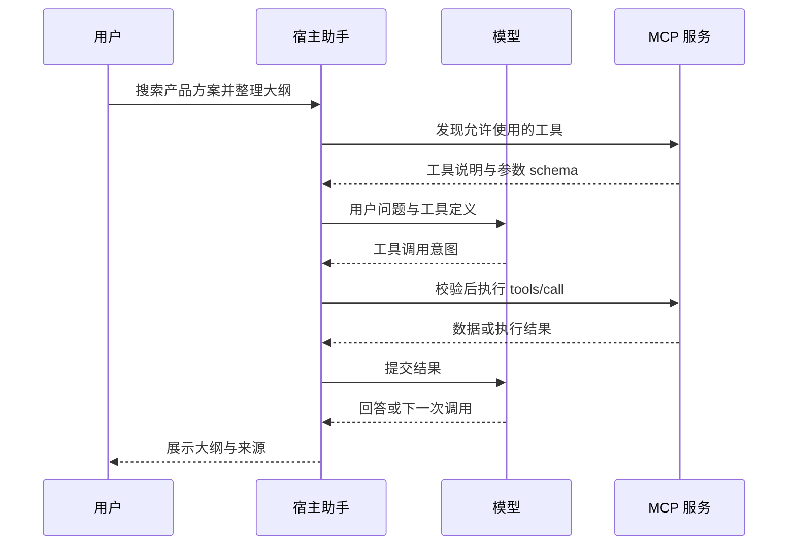

# MCP 连接器技术调研与纯前端产品边界

日期：2026-10-18。适用项目：document。本次决策：移除 AI 助手主动连接外部 MCP 和 Google Drive 的功能，保留本地参考文件、来源引用、成果管理及现有模型配置。项目继续以无站点账户、可静态部署、本地优先的文档编辑器为定位。

这是一项产品边界选择。标准 MCP 客户端在浏览器中有可行实现，但纯浏览器无法保证接入任意厂商服务；为了扩大覆盖而增加账户、凭据托管、网关或本地伴随程序，会改变本项目的部署与信任边界。本文保存会话中的调查事实、原理解释、方案演变及最终取舍，作为后续讨论的依据，不作为连接器开发计划。

## 会话中的目标变化

| 阶段         | 用户关注点                            | 得出的结论                                                                                     |
| ------------ | ------------------------------------- | ---------------------------------------------------------------------------------------------- |
| 同步与排查   | 同步远程主分支，找出现有连接器的卡点  | 当时 `main` 与 `origin/main` 一致，提交为 `db4ddcd8`；Drive 配置、MCP 能力和上下文截取均有限制 |
| 理解连接器   | 连接器怎样让 AI 获取外部信息          | 连接器处理授权和访问，模型接收工具说明与结果，宿主应用执行实际调用                             |
| 完善方案     | 如何改善资料读取、连接状态和引用      | 最初提出的方案偏向参考资料管理，未覆盖用户期望的通用工具接入                                   |
| 澄清扩展目标 | 接入 Figma、Notion、Longbridge 等 MCP | 应使用标准 MCP 客户端、动态工具发现和统一工具适配，避免逐家重写协议                            |
| 约束核对     | 当前项目纯前端，是否还可实现          | 可以实现浏览器直连，但服务的 CORS、公共客户端授权和准入政策构成外部条件                        |
| 业界对照     | 为什么成熟产品可以广泛连接            | 云端代理和本机运行时承担了网页不能承担的网络、凭据和进程管理                                   |
| 最终决定     | 无账户纯前端定位优先                  | 保存研究，删除外部连接器；不继续开发 MCP Host、账户系统或代理网关                              |

移除工作开始时，原工作区已切换至其他开发分支并有未提交改动，因此本次实现从当时已提交的 `ae350c3d` 创建独立 worktree，不搬移或覆盖原工作区改动。上表中的主分支同步结果是调研开始时的历史事实，不代表删除开始时重新同步过主分支。

## 连接器涉及的角色

模型服务与连接器解决不同问题：模型服务执行推理，连接器提供外部数据或操作能力。一个模型可以使用多个连接器，一个连接器也可以供不同模型使用，前提是宿主能把工具定义与执行结果适配到当前模型。

- **Host，宿主应用**：本项目的 AI 助手。管理用户选择、权限、上下文、工具执行、取消和结果呈现。
- **MCP Client，客户端组件**：宿主内部与某个 MCP 服务通信的组件。多个服务需要分别隔离其连接配置和授权状态。
- **MCP Server，外部服务**：提供工具、资源或提示模板，将协议请求转换成其业务系统的操作。
- **授权服务**：让用户登录、同意权限并颁发访问凭据。它可能与 MCP 服务属于不同域名。
- **模型**：根据用户问题和可用工具提出调用意图；网络请求由宿主执行。

MCP 标准化消息与能力交换，不替宿主决定使用哪个模型、保存哪些资料、如何审批操作，也不要求某一种产品账户体系。常见的 `mcpServers` 配置是客户端生态约定，不能当作 MCP 协议规定的唯一配置格式。

## 一次工具调用怎样完成

以“从 Notion 找产品方案，整理成当前 Word 文档的大纲”为例：

1. 用户添加 MCP 服务地址并选择连接。
2. 客户端发现授权要求，完成适用的 OAuth 流程或使用用户提供的凭据。
3. 客户端依据服务支持的协议版本建立通信并发现能力。
4. 通过 `tools/list` 获得工具名称、说明和参数 schema；只向模型提供本次允许使用的工具。
5. 模型提出搜索调用，宿主校验参数与权限后发送 `tools/call`。
6. 服务执行搜索并返回结果；模型可能继续请求读取页面。
7. 宿主把结果纳入受限上下文，模型生成大纲。修改当前文档仍应走原有预览与确认流程。

会话最初使用现有客户端的 `2025-11-25` 握手式流程讲解，其中包含 `initialize` 与 `notifications/initialized`。这不是对所有未来版本固定不变的实现要求。当前 SDK 与协议文档已有更新，若未来另立项目实现客户端，应由经验证的 SDK 处理协议版本差异，避免继续手写并固定旧版本。

读取工具也可能通过 `tools/call` 提供；不能因为只需要读数据，就假设所有服务都有 `resources/list`。资源、工具和提示模板是不同的能力。

## 三个厂商示例

| 服务       | 官方远程入口                 | 接入条件与能力                                                                                                 |
| ---------- | ---------------------------- | -------------------------------------------------------------------------------------------------------------- |
| Figma      | `https://mcp.figma.com/mcp`  | 设计相关工具，通过 Figma 登录授权。调研当日官方文档注明新客户端需要申请准入，不能仅凭实现标准协议就承诺可用    |
| Notion     | `https://mcp.notion.com/mcp` | 搜索、读取和更新工作区内容；官方提供自定义客户端的 OAuth、PKCE、客户端注册和刷新 Token 指南                    |
| Longbridge | `https://mcp.longbridge.com` | 行情、账户及交易等工具；能力受地区、账户和授权范围影响。其官方另提供中国大陆入口，账户适用范围需按厂商文档选择 |

标准化的收益是复用客户端与工具发现机制。厂商客户端准入、OAuth 注册策略、账户权限、工具结果类型和配额仍需分别验证。“可添加任意地址”与“保证任意服务可用”是两个不同承诺。

## 调研时项目已有实现与卡点

下列是删除前实现的历史记录，文件路径用于定位 Git 历史，不表示功能仍在当前版本提供。

| 范围                                          | 已实现内容                                                            | 主要限制                                                                               |
| --------------------------------------------- | --------------------------------------------------------------------- | -------------------------------------------------------------------------------------- |
| 本地参考文件                                  | 文本、DOCX、XLSX、PPTX、含文字 PDF 的浏览器读取、会话附件、预览和引用 | 最多五份附件；解析有大小、页数和时间限制，扫描 PDF 没有 OCR                            |
| `connectors/reference-sources.ts` 中的 MCP    | Streamable HTTP JSON/SSE、内存 Bearer Token、列出和读取资源           | 无 OAuth、工具调用、资源模板、stdio；固定 `2025-11-25`，未据服务能力选择资源操作       |
| `ui/sources-view.ts` 中的 Drive               | 弹窗授权、浏览文件、文件名搜索、读取和断开                            | 依赖专用服务端；初始化不核实状态，多类错误合并成通用失败提示                           |
| `functions/api/connectors/google/[[path]].ts` | OAuth、PKCE、加密 HttpOnly Cookie、受控 Google API 请求               | 需要部署端配置与 Google OAuth 应用，真实授权尚未完成验收；会话最长一小时，无刷新 Token |
| Drive 文件覆盖                                | Google Docs 导出纯文本及部分文本格式                                  | 不包括 Sheets、Slides、云端 Office/PDF                                                 |
| `ui/request-context.ts`                       | 受限摘录、S1–S5 引用 ID、最终请求证据                                 | 约 4 KiB 预算还需容纳指令等信息；从正文开头截取，相关段落在后面时容易丢失              |

本次会话实际取得的证据：

- 公开的 Drive `/api/connectors/google/status` 返回 HTTP 503，JSON 为 `configured:false`、`connected:false`、`error:not_configured`。这说明当时路由可达但配置检查失败；并未检查部署后台的各项凭据，不能指出具体缺少哪一项。
- 六个相关单元测试文件共 47 个用例通过；Google 请求为模拟响应，不等同于真实 OAuth 与文件读取验收。
- 对现有 MCP 源码的受控探针：返回其他版本时得到 `source-protocol`；仅提供 tools 的服务仍被调用 `resources/list`，最终得到 `source-invalid-response`。该探针验证的是客户端行为，没有登录任何厂商账户。
- 对现有序列化函数的合成中文长文探针：每份约 20,011 字，一份资料时保留 1,120 字，五份时每份 192 字，放在末尾的“预算为42万元”均未进入请求。数字仅对应当时的合成输入与指令，不是每个请求固定可用的字数。

## 纯前端能做什么

纯前端是指本站没有自建业务后端；第三方 MCP 服务仍运行在外部服务器。浏览器可以通过 HTTPS 和流式响应实现协议请求，也可以完成公共客户端 OAuth。技术可行性需要逐条满足外部条件。

### 浏览器跨域访问

跨域请求是否允许由目标服务器的 CORS 响应决定。MCP 请求、授权元数据、客户端注册、Token 换取和刷新涉及的各个地址都需要检查。仅 MCP 地址的预检成功，不代表整条授权链路成功；SDK 和 `no-cors` 也不能解除浏览器的访问限制。

需要发送的请求头和需要读取的响应头都影响兼容性，例如 Authorization、协议版本、会话标识和授权挑战。`Access-Control-Allow-Headers: *` 不能替代对 Authorization 的显式允许；没有带 Cookie 时某些其他通配符才具有预期语义。正式验收应在真实浏览器中执行，而不是把命令行响应当作浏览器放行结果。

### 前端 OAuth

OAuth 不必然要求本站后端。若授权方支持公共客户端、授权码加 PKCE、合法回调地址和相应跨域访问，前端能够发起登录并换取 Token。客户端 ID 可以公开，客户端密钥不能在前端保密。要求保密客户端密钥的授权方案需要后端或本机程序协助。

PKCE、state 与授权方校验、客户端注册、凭据生命周期、刷新 Token 轮换及撤销都属于实际工作量。把用户 Token 放入一个输入框，并不能视为已经支持通用 OAuth。浏览器存储也不等同于 HttpOnly Cookie 或操作系统密钥链。

### 本地进程

普通网页无法直接运行 `npx`、Python 或启动 stdio MCP 子进程。浏览器扩展、本地伴随程序、桌面壳或代理可以提供桥接，但这些会增加安装或服务依赖。连接已运行的本地 HTTP 服务是另一种情况，仍需满足跨域、服务端 Origin 校验和浏览器本地网络访问条件。

### 本次初步跨域探针

探针向三个公开入口发送 OPTIONS 和未认证 GET，并携带 `Origin: https://edit.chaxus.com`。没有使用 Token、完成登录、调用业务工具或操作账户。

| 服务       | 观察                                                             | 结论边界                                                         |
| ---------- | ---------------------------------------------------------------- | ---------------------------------------------------------------- |
| Notion     | OPTIONS 和 GET 均得到 403，未观察到允许跨域的响应头              | 本次环境未确认可直连，不能由此断言所有浏览器和未来部署永远不支持 |
| Figma      | OPTIONS 为 200，返回部分 CORS 允许头；GET 为 405                 | 不能证明客户端准入、OAuth 或带会话标识的请求成功                 |
| Longbridge | OPTIONS 为 200，返回 CORS 通配头；GET 为 401，返回授权元数据地址 | 不能证明带 Authorization 的预检、Token 换取及刷新链路可用        |

因此，本次调查没有得出“Figma、Notion 和 Longbridge 均已支持本项目纯前端直连”的结论。

## 业界连接放在哪里

| 路线           | 网络请求从哪里发出                                        | 代表与特点                                                                    |
| -------------- | --------------------------------------------------------- | ----------------------------------------------------------------------------- |
| 云端连接       | 网页调用产品后端，后端访问 MCP 与授权服务                 | Claude 官方明确说明远程连接来自其云端基础设施，即便用户使用桌面客户端         |
| 本机连接       | 桌面程序、IDE 或本机进程访问 MCP，必要时启动 stdio 子进程 | Cursor、VS Code 提供本地命令与远程 HTTP 等配置能力                            |
| 网页配本地后端 | 浏览器提供操作界面，本地后端承担连接与凭据职责            | 官方 MCP Inspector 的网页版本配有 Node 后端，不能因界面在网页中就认定其纯前端 |
| 浏览器直连     | 网站 JavaScript 直接访问第三方服务                        | 可以实现，但受 CORS、公共客户端授权、厂商准入与本地进程能力限制               |

上述例子说明架构选择，不构成市场份额统计。协议标准与运行位置是两个维度：使用官方 SDK 并不意味着必须增加云端后端，保留纯前端也不意味着能获得桌面客户端的全部连接能力。

## 曾讨论的方案与最终取舍

最初讨论了三条改进路径：只补 Drive 配置；完善资料连接、状态与相关摘录；实现通用 MCP Host。用户澄清后，通用方案收敛为官方 SDK、配置化服务、动态工具发现、OAuth 管理、到现有 `AgentTool` 的统一适配，以及宿主执行控制。

随后讨论了浏览器默认直连、可选网关或本地程序的连接分层。它能够扩大长期扩展空间，但“可选”仍意味着需要额外维护凭据与网络信任边界，不能把这一方案当作现有纯前端已经具备的通用能力。

用户最终明确选择无账户纯前端定位，撤回继续建设外部连接器的方向。不存在“先保留隐藏入口、等待未来接通”的当前需求，也没有创建 OAuth 应用、网关或账户系统的实施任务。

## 删除范围与兼容边界

删除外部 MCP 客户端、Google Drive 界面、授权回调通道、Google Functions、专用 Functions 路由配置、连接器专用文案和远程连接用例。把仍需保留的本地资料读取模块迁至 `lib/agent-plugin/references/`，并更新所有实际消费者和离线构建测试。

保留以下行为：

- 用户手动添加本地文件，浏览器解析、搜索、预览、移除和五份附件上限。
- 会话之间的附件隔离、排队请求快照、取消和迟到结果失效处理。
- 请求上下文预算、最终发送摘录的引用、已保存对话与成果的兼容读取。
- 成果保存、版本、编辑、导出和文档修改预览。
- 用户主动配置的模型服务；它属于推理目的地，不属于此次删除的外部账户连接器。
- 现有 embed API、编辑器工具及向外部浏览器代理暴露编辑器能力的 WebMCP。它们与助手主动连接第三方 MCP 的方向不同。

持久化来源记录中的 `connector` 字段继续作为历史来源类型元数据保留，避免为删除访问入口而修改已有对话与成果格式。旧来源链接仅作为记录展示，不会恢复远程连接。Service Worker 对 `/api/` 保持一般性网络绕过，避免 API 或旧授权链接被当作离线页面缓存；这不提供任何连接器路由。

## 实施步骤与验收

本次直接执行用户已经授权的删除，不创建新平台或依赖包。最小方案是删除远程分支并复用本地资料生命周期，而不是重建资料存储或迁移历史数据库。

1. 在独立 worktree 记录调研与产品决定，先验证原有相关测试基线。
2. 调整测试，证明资料页仅有本地操作、在线离线切换不产生连接请求；保留附件容量、取消和历史引用覆盖。
3. 删除 MCP 与 Drive 代码、后端和路由；迁移本地资料目录并更新七种语言、样式及现行开发文档。旧设计/计划仅增加被本决策替代的说明，保留历史正文。
4. 运行相关及全量单元测试、格式/lint/类型检查、生产构建，并用真实浏览器覆盖本地资料、引用、成果和会话切换。
5. 检索运行时与构建入口，确保没有剩余远程连接实现；检查原工作区改动未被覆盖。

具体变更归属：`ui/sources-view.ts` 与 `ui/workspace-labels.ts` 负责收敛本地界面；`references/` 接收原本地读取模块；`packages/shared/src/i18n/` 删除专用文案；`functions/` 与 `public/_routes.json` 移除服务端部署入口；`public/sw.js` 与相关路由测试改为一般 API 绕过；`styles/assistant.css` 删除远程专用样式；相关单元/E2E、当前开发说明及 `CHANGELOG.md` 同步。

验收重点：资料页没有地址、Token 或账户授权控件；本地附件仍可用于 AI；切换会话或取消后不附加迟到文本；旧对话引用及成果版本仍可读取；生产构建不携带外部连接器后端。既有模型服务连接和 WebMCP 不应被误删。

## 移除后的验证结果

- 删除前相关测试基线：六个文件、47 个用例通过。
- 本地资料页回归用例先在旧实现下失败：实际存在地址和 Token 两个控件，期望为零；删除后通过。
- 相关本地资料、引用、国际化、离线路由和构建图测试：八个文件、63 个用例通过。
- 全量单测：`pnpm exec vitest run --maxWorkers=2`，250 个文件、6,746 个用例通过。首轮默认并发运行出现失败并中止，随后降低并发完成全量复核；没有为消除这些首轮失败而修改无关业务逻辑。
- Chromium：`E2E_PORT=4287 pnpm exec playwright test test/e2e/agent-sources-artifacts.spec.ts test/e2e/agent-document-references.spec.ts --workers=2`，九个用例通过，涵盖本地 Office/PDF、引用恢复、离线成果、附件容量和迟到读取的会话隔离。模型响应使用受控测试服务，不是模型质量评测。
- `pnpm run lint:ts`、`pnpm run format:check`、`pnpm run build` 均通过。生产资产中未检出远程连接器标识，未输出 `_routes.json` 或 Cloudflare Functions Worker。
- 独立只读代码审查未发现需要修改的问题；文档相对链接与差异空白检查通过。删除的是仓库实现，本次没有部署线上，也没有变更厂商授权或 Cloudflare 环境配置。

## 官方参考资料

以下页面在本次会话中查阅，内容状态以 2026-10-18 为时间点；厂商政策和 SDK 后续可能改变。

- [MCP 架构](https://modelcontextprotocol.io/specification/2026-07-28/architecture)：Host、Client、Server 的职责和协议边界。
- [MCP 授权规范](https://modelcontextprotocol.io/specification/2026-07-28/basic/authorization)：公共客户端、授权发现与客户端注册等要求。
- [官方 TypeScript SDK](https://github.com/modelcontextprotocol/typescript-sdk)：协议客户端、传输和授权辅助能力；历史示例中的包名不能替代实施时的版本确认。
- [Figma 远程 MCP 接入](https://developers.figma.com/docs/figma-mcp-server/remote-server-installation/)：官方地址、授权及客户端准入。
- [Notion 自定义 MCP 客户端](https://developers.notion.com/guides/mcp/build-mcp-client)：OAuth、PKCE、注册、刷新和连接要求。
- [Longbridge MCP](https://open.longbridge.com/docs/mcp)：官方入口、账户权限和 OAuth 兼容要求。
- [MDN CORS](https://developer.mozilla.org/en-US/docs/Web/HTTP/Guides/CORS)：浏览器跨域、预检和响应头规则。
- [Claude 远程连接器网络位置](https://support.claude.com/en/articles/11175166-get-started-with-custom-connectors-using-remote-mcp)：请求来自云端基础设施。
- [Cursor MCP](https://prod.cursor.com/docs/mcp)、[VS Code MCP](https://code.visualstudio.com/docs/agent-customization/mcp-servers)：本地和远程接入能力。
- [官方 MCP Inspector](https://github.com/modelcontextprotocol/inspector)：网页界面与 Node 后端组成。
