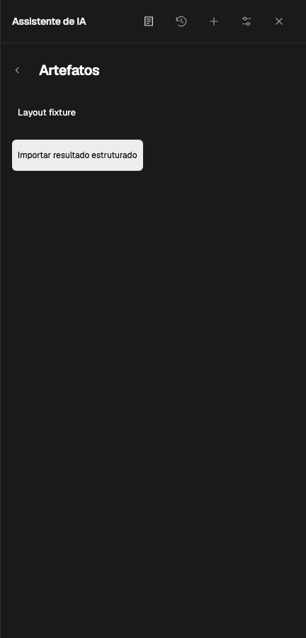

# Assistant layout contract acceptance

Date: 2026-10-20

## Result and scope

The assistant now shares a 16px content rail across its header, onboarding, Models,
Conversations, Sources and Artifacts. Navigation headings use a declared second rail
(48px for fine input, 54px for coarse input), while the back icon viewport returns to
the content rail. A framed control's text keeps its own inset; its frame, text and
hit area are measured separately.

The companion [ran PR #434](https://github.com/chaxus/ran/pull/434) defines the reusable
composition and acceptance rules. It changes guidance and test examples, so this
consumer does not need a dependency upgrade. Product dimensions remain in
`styles/assistant.css` and [the application design contract](../design-system.md#assistant-application-layout-contract).

## Inspected surfaces

| Surface                | Rendered acceptance                                                                                           |
| ---------------------- | ------------------------------------------------------------------------------------------------------------- |
| Onboarding             | Header, welcome heading and explanatory text share the content rail                                           |
| Runtime header/chat    | Actual title text and compact hover area; visible actions; draft retained on return                           |
| Models                 | Heading/navigation rails, picker frames and actual ranui selection-item text; internal control inset retained |
| Conversations          | Search frame, empty state, populated conversation text and History & data disclosure                          |
| Sources                | Intro/search group gap, search frame, attached reference preview, expanded excerpt and status                 |
| Artifacts list         | Empty explanatory text, populated list, Import action and their group gap                                     |
| Artifact import/editor | Shared header after async refresh, form labels/fields, save and return to list/chat                           |

The geometry matrix exercises a 432px desktop panel, 360px and 320px windows,
English and Portuguese, both themes, fine and coarse input, and long synthetic
translations. Header targets stay inside the panel, do not overlap, and retain
44px minimum dimensions with coarse input. At widths up to 360px the readable
title occupies a row above the five actions. Keyboard checks establish
`:focus-visible`, inspect the complete back-button outline and return with Enter.

Representative current renders:

## Failures caught before the fixes

| Evidence                   | Before                                                     | Accepted result                   |
| -------------------------- | ---------------------------------------------------------- | --------------------------------- |
| Title text Range           | 24px despite a correctly placed outer button               | 16px                              |
| Welcome copy               | 28px                                                       | 16px                              |
| Title hover                | Expanded into toolbar filler                               | Text width plus 16px padding      |
| Narrow translated header   | Truncated by five adjacent actions                         | Readable title above action row   |
| 432px coarse header        | Title inherited a 44px icon flex basis                     | Title keeps its own content basis |
| Coarse back focus          | 2px gutter could not contain a 2px outline plus 2px offset | Zero offset; full outline visible |
| Sources intro/search       | No group separation                                        | 16px                              |
| Populated artifacts/Import | No group separation                                        | 16px                              |

The tests also inject an 8px text-only drift while retaining the same outer width,
expand the title into flexible filler, and shift a sibling view's padding. Each
mutation must fail the acceptance assertion, and restoration must pass. This
prevents an aligned wrapper or a stored screenshot from becoming false evidence.

## Verification

- `pnpm test:coverage`: 252 files and 6,801 tests passed. Coverage: statements
  87.79%, branches 83.94%, functions 88.77%, lines 90.25%.
- `pnpm lint:ts`, `pnpm format:check`, `pnpm build` and `git diff --check` passed.
  Archive verification retained all 1,511 immutable evaluation artifacts.
- The related Chromium navigation/workspace/source/artifact/history regression run
  passed 23 tests. The expanded final layout suite adds populated conversation and
  source disclosure coverage; its seven cases run in Chromium, Firefox and WebKit.
- Final layout acceptance: Chromium 7 passed; Firefox/WebKit 14 passed. All three
  browsers ran with retries disabled.
- Review findings about coarse title sizing and focus clipping were fixed and
  checked against a fresh production preview.

The first full coverage attempt overlapped browser work and hit an existing 5s
file-read timeout; the isolated complete rerun passed. A newly added populated
conversation fixture initially omitted legacy session metadata; correcting the
fixture made that case pass without a production logic change.

These checks cover assistant composition and related interactions. Native browser
zoom and the full repository browser/Docker suite are outside this focused run.
Persistence, model loading, document writes and dependency versions are unchanged.

## Follow-up: grouped history commands

History & data uses content-sized native command buttons in one column. Restore/Import/Export
share the checkbox's icon/control and text columns, with 8px between buttons and a 16px gap
before destructive commands. Each button owns a quiet resting surface and functional stroke;
there is no inner group outline, group fill, row rule or deletion divider. Hover/press,
keyboard focus, disabled states and explicit danger confirmation remain distinct.

Earlier framed groups and inset separators repeated the pane's existing boundary. Removing
those enclosures was appropriate, but the subsequent all-flat treatment also erased resting
affordance. It measured alignment only within the command list, missing adjacent checkbox
columns. The current revision retains the simplified grouping while restoring each native
button's own functional shape. Acceptance records the complete pane as well as the command
region, with the pointer away, and checks shared visible columns rather than equal row widths.

The runtime baseline after adding icon/label rows passed all 252 unit files / 6,801 tests
(including 274 focused history/panel/write tests), lint/typecheck and the production build.
Two existing non-fatal `PromiseRejectionHandledWarning` messages were printed. The subsequent
composition and affordance revisions change CSS, browser acceptance and prose; runtime logic is unchanged.
The coverage percentages above belong to the earlier layout-only coverage run.

## Revision scope: remove redundant command enclosures

The user rejected the remaining nested-box appearance. This revision applies ran's existing
composition rules (avoid redundant nested containers; establish hierarchy with type and spacing)
to the complete settings pane rather than refining a cropped card in isolation.
The starting evidence below refers to document `515e7ba6` and ran `911ee0853`.

| Assumption                                                                             | Evidence                                                                                | Decision                                                                         |
| -------------------------------------------------------------------------------------- | --------------------------------------------------------------------------------------- | -------------------------------------------------------------------------------- |
| Existing guidance already discourages decorative nested frames                         | Code fact: ran `packages/ranui/docs/DESIGN.md`, composition and spacing sections        | Clarify how this wins over the optional framed-command example                   |
| History has a section divider, a transfer frame, row separators and a deletion divider | Code fact: `styles/assistant.css`, history options/transfer/danger rules; renders above | Retain the major section boundary; remove the three redundant command treatments |
| Group framing is currently required by acceptance                                      | Code fact: `test/e2e/agent-history-actions.spec.ts`, resting group assertions           | Verify full-row geometry and interactions without mandating an enclosure         |
| Native controls own persistence, confirmation and focus                                | Code fact: `lib/agent-plugin/ui/history-controls.ts`                                    | Leave runtime code unchanged                                                     |

Allowed changes: ran's `DESIGN.md`, `INTERFACE_GUIDE.md`, English/Chinese design-guide
entry points; document's assistant CSS, existing history-action browser acceptance,
design contract, this acceptance record and history command/full-pane screenshots.
Forbidden changes: tokens, component defaults/APIs, dependency versions, vendor files,
history/state/storage code and unrelated site layouts.

Compatibility red lines: keep the panel boundary, field borders, keyboard focus outlines,
44px targets, icon/label columns, accessible names, destructive confirmation and draft/focus
return behavior. The composition uses a single command column with one 16px gap before
destructive actions. It needs no replacement card, muted group fill, raised shadow or new
abstraction. Native buttons may own a functional surface; removing group wrappers must not
remove the cue that an individual control is clickable.

Acceptance: inspect the whole pane and its command region in both themes and at desktop,
360px and 320px widths; use the existing English/Portuguese, pointer/keyboard, disabled,
contrast, download, touch and confirmation checks. Verify the documentation and formatting
gates in ran. The review must explain the purpose of each remaining stable boundary.

## Remaining boundary review

| Surface                | Boundary retained                                              | Distinct purpose                                                                   |
| ---------------------- | -------------------------------------------------------------- | ---------------------------------------------------------------------------------- |
| Assistant/editor       | Panel edge                                                     | Independent sidebar and resize boundary                                            |
| Models and Sources     | Picker/search/input frames                                     | Values that can be edited or selected                                              |
| Conversations          | Search field and one History & data section rule               | Search input and a major change from conversation browsing to data settings        |
| History command groups | No group enclosure; individual secondary button surfaces       | Type/proximity express grouping; each button shape identifies an actionable target |
| Command focus          | Keyboard outline                                               | Transient focus state, not decorative containment                                  |
| History deletion       | Solid confirmation button                                      | Explicit destructive commitment after the existing confirmation step               |
| Artifacts              | Form/control boundaries and task-specific save/apply hierarchy | Editable values and explicit document/result operations                            |

Earlier flat-composition verification (before the affordance correction below): the history/layout Chromium suite passed all 10 cases;
the Firefox/WebKit history-action suite passed all six cases. Retries were disabled.
The updated row-edge acceptance first failed on the old enclosure's 2px reduction in
available target width, then passed after the redundant frame/insets were removed.
Ran documentation/link/eight-locale checks and changed-file formatting passed.

## Resting affordance and shared control columns

User review exposed two acceptance gaps in document `9f3c5a4c` / ran `320a91da6`.
Real Chromium measurements relative to History & data found the checkbox at 0px with its
label at 24px, while command icons started at 12px and command labels at 42px. The five
commands aligned with each other, but not with the adjacent control. Their resting background
also equalled the panel canvas, so icons and verbs could read as static content.

The correction keeps the existing allowed file scope and runtime compatibility red lines.
It replaces the universal flat-row prescription in ran with context-dependent control affordance:
remove redundant wrappers, retain an individual standalone button's recognizable resting shape.
Document now uses 16px SVG viewports, 8px icon gaps and padding, and an explicit 8px inline-start
target extension into the owned gutter. Measured checkbox/icon edges are 16px from the panel
origin; all related text starts at 40px. The extension stays inside the pane and does not cause
horizontal scrolling. Content-sized buttons avoid a large empty full-row target.

The new browser acceptance failed on the old geometry before implementation. Its first run
against the new surfaces caught light-mode danger text contrast of 4.475:1 and an 8px scroll
extension. Using the existing darker danger foreground role and limiting the extension to
inline-start corrects those actual failures. Surface differences are an automated guard,
not evidence that user discoverability has been measured; screenshots still require visual review.

Final persisted-theme affordance verification: Chromium History 3 passed; Firefox/WebKit History 6 passed;
Chromium shared layout 7 passed, all without retries. The History cases cover both themes,
English/Portuguese at desktop, 360px and 320px, shared checkbox/icon/text columns, resting
surface distinction, readable danger states, disabled/hover/press, keyboard focus, Enter/Escape,
focus return, real export downloads and 44px touch targets. The renders above are current
Firefox browser captures, including the full pane. Visual review found no remaining
implementation issue; its stale-contract wording finding was corrected in this record and
the application design guide. Lint/typecheck, changed-file formatting, production preview
build, ran docs/eight-locale/link checks and whitespace checks passed. Runtime logic remains
unchanged; the prior 6,801-test runtime baseline was not rerun for this CSS/docs-only correction.

Screenshot inspection also caught a theme-coverage gap: the media-emulated Firefox run
produced light renders under dark filenames. Its initial passing result did not establish
dark-mode coverage. The final History matrix selects the product's persisted `ran-theme`
choice at boot and asserts `data-ran-theme` before recording either theme. Final screenshots
replace those incorrect evidence files. This checks the rendered saved-theme setting; it does
not establish the cause of the Firefox system-media discrepancy.
