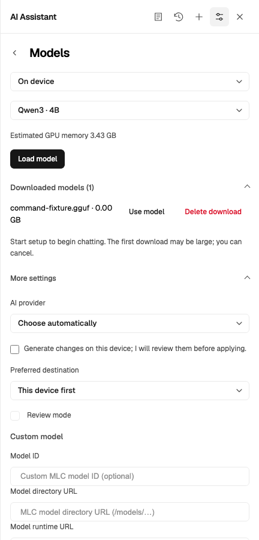
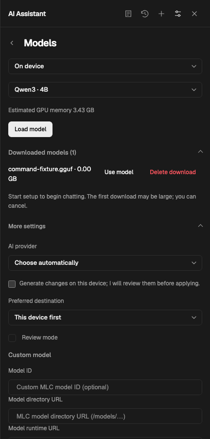
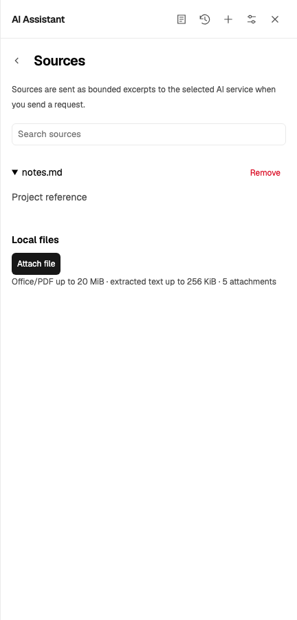
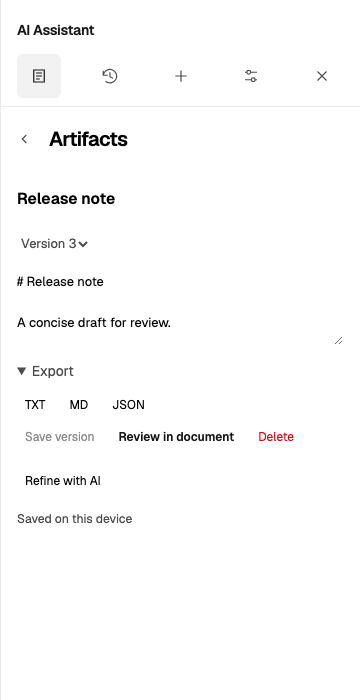
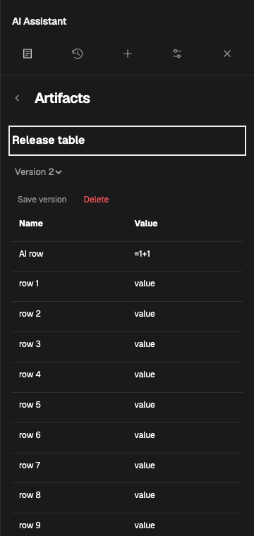
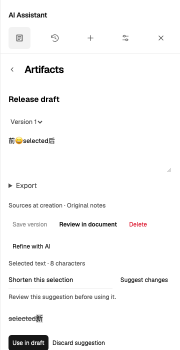
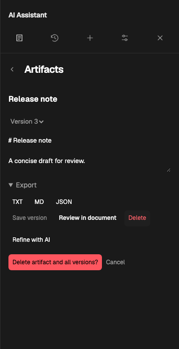

# Models, Sources and Artifacts boundary audit

Date: 2026-10-20. Baseline: `4ed5d28a`.

## Scope and evidence

The requested outcome is a consistent flat workspace across complete views and expanded
states. The user explicitly asks to apply the distinct-boundary standard beyond History.

| Finding                                                              | Evidence grade                                                                                                                           | Decision                                                                                              |
| -------------------------------------------------------------------- | ---------------------------------------------------------------------------------------------------------------------------------------- | ----------------------------------------------------------------------------------------------------- |
| Model device/service sections already have no card frame             | Code fact: `styles/assistant.css`, `.agent-use-card` / `.agent-service-section`; runtime fact: baseline Models and service screenshots   | Retain flat containers and functional picker/endpoint field frames                                    |
| Cache rows and settings disclosures stack rules with existing gaps   | Code fact: `.agent-model-cache`, `.agent-model-cache-row`, `.agent-preferences`; runtime fact: baseline Models                           | Use existing summary headings and spacing; remove decorative rules and duplicate group inset          |
| Source rows touch the search field; each removal has its own outline | Runtime fact: baseline `sources.png` / `source-search-preview.png`; code fact: `.agent-source-row` and blanket workspace button border   | Separate search/results with a group gap, top-align expanded previews and use a quiet removal command |
| All artifact/workspace commands inherit an outline                   | Code fact: shared `.agent-workspace-view button, .agent-artifacts button`; runtime fact: baseline text/table/slides/revision screenshots | Remove blanket command framing, give explicit primary/destructive roles their own states              |
| Structured data and revision previews already use flat viewports     | Code fact: `.agent-artifact-data-preview`, `.agent-artifact-workflow`; runtime fact: baseline structured/revision screenshots            | Keep table row rules, bounded scrolling, diff feedback and field/focus cues                           |

Baseline: all 13 existing source/artifact/revision/workspace browser cases passed.
The audit includes full-page screenshots, not just cropped buttons.

## Allowed changes and compatibility

Allowed: `styles/assistant.css`; semantic attach/remove classes in
`lib/agent-plugin/ui/sources-view.ts`; existing source/artifact/revision/workspace/layout
browser acceptance and screenshots; `docs/design-system.md`, this record, and media under
`docs/media/assistant-layout/`.

Unchanged: runtime/store/provider ownership, persisted schemas, requests, model downloads,
document writes, public APIs, dependencies, foundation values and vendor code. Preserve
drafts, selection, async cancellation, downloads, native disclosure/keyboard semantics,
danger confirmation, disabled states, layout rails and 44px coarse-pointer targets.

## Composition decisions

- Models: rely on disclosure titles and the existing 16px section gap. Cached entries use
  proximity rather than row rules. Endpoint and model fields retain their control frames.
- Sources: the search frame identifies editable input, the attached list is a separate
  flat region, and an expanded excerpt keeps its own bounded scroll viewport. Remove
  stays beside the source title instead of centering against the entire expanded excerpt.
  Attach file is the explicit primary entry action.
- Artifacts: saved results are full-width flat rows. Import/Save/Use in draft have primary
  roles; ordinary review/export/page/revision controls use quiet hover/focus surfaces.
  Delete has a quiet danger role and explicit confirmation has a solid danger role.
- Data and editing: table row rules convey cell relationships; JSON/import fields and
  the revision instruction remain identifiable inputs. No replacement card, added group
  fill, nested shadow or additional shared component is needed.

## Acceptance

Run the existing complete source/artifact, AI revision, workspace and alignment suites.
Inspect local/service Models, empty/populated cached inventory, expanded preferences,
source attachment/search/preview/removal/offline/recovery, artifact empty/list/import,
text/table/slides/edit/export/revision/confirmation states. Check light/dark, desktop,
360px/320px, English/Portuguese, coarse input, focus, disabled and busy states.

Keep boundary evidence and representative renders here. Verify type/lint, formatting,
the production build and relevant source-view/runtime tests if markup changes. Review
both ordinary and explicit destructive/primary states before updating the existing PR.

## Inspected state inventory

| View                  | States exercised                                                                                                                          | Boundary decision                                                                                                    |
| --------------------- | ----------------------------------------------------------------------------------------------------------------------------------------- | -------------------------------------------------------------------------------------------------------------------- |
| Models                | Local and service configuration, cached GGUF entry, expanded preferences/custom fields, delete/cancel/pending, offline availability       | No section/entry rules or outer cards; preserve actual picker/field/control surfaces and disabled/danger roles       |
| Sources               | Empty, attached file, open excerpt, search highlight, removal, attachment limit/error recovery, pending read cancellation and offline use | Search and results separated by a 16px gap; title and Remove stay together while the excerpt expands; no result card |
| Artifacts list/import | Empty, populated list, return to list, title/JSON import and validation recovery                                                          | Full-width flat list rows; explicit Import/Save entry roles; retain editable field cues                              |
| Artifact editor       | Text and versions, dirty discard/cancel, export formats, delete confirmation/cancel and continued draft                                   | Quiet ordinary commands, primary saves, quiet danger intent and solid destructive confirmation                       |
| Structured results    | Editable table and slides, pagination, offline CSV export, complete payload preservation                                                  | Keep data row relationships and bounded viewport; remove outlines from page/export commands                          |
| AI revision           | Instruction input, selection/full scope, waiting, proposal diff, accept/discard/stop, stale edits and conflict recovery                   | Flat disclosure/form/proposal with functional input and diff feedback; no nested card                                |

## Representative renders

## Verification

- Baseline: 13 source/artifact/revision/workspace cases passed.
- Final Chromium: all 20 cases passed, including the seven alignment/onboarding cases.
- Final Firefox/WebKit: all 26 source/artifact/revision/workspace cases passed.
- All browser runs disabled retries. Rendered states cover both themes, desktop and
  360px/320px widths, English/Portuguese, keyboard return, coarse input and actual exports.
- `pnpm lint:ts`, production build, changed-file formatting and `git diff --check` passed.
  Archive validation retained all 1,511 immutable evaluation artifacts.
- Independent review found no actionable issues. Whole views, expanded states, explicit
  primary/danger/disabled states and the retained functional field/focus boundaries were reviewed.
- Final `pnpm test`: 252 files / 6,801 tests passed. The two existing non-fatal
  `PromiseRejectionHandledWarning` messages were unchanged.

Rendered follow-up found a remaining raised-button base on Models cache commands: making
the documented content part transparent left the ranui host's default shadow visible.
The application now uses the existing public `--ran-btn-box-shadow` and
`--ran-btn-surface-background` hooks to remove that decorative layer. A real-host shadow
assertion first failed with the inherited raised shadow, establishing the regression.
Functional component borders, primary fills, focus and coarse targets remain separate.
After that final adjustment, the cache use/delete/cancel/pending case passed again in
Chromium, Firefox and WebKit without retries; expanded Models captures were refreshed.
