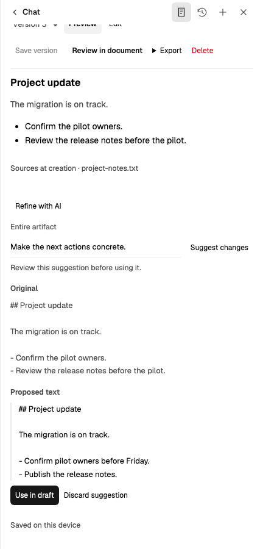
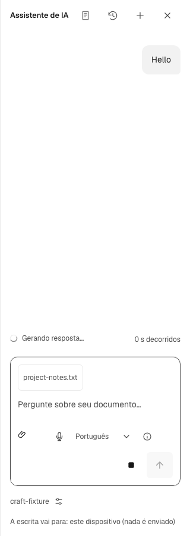

# Assistant conversation and artifact craft acceptance

Historical runtime source: `d6c0411372e168a5a1c124c82408b7499e7e3cc2`.
Build SHA-256: `23a96f4182123707557f63f43762b563cdfcd91f25f9a9aaccb20561081123b0`.
Upstream ran source: `72c44840707ee5dc88a3e60e5a4906f73a7fc98d` ([PR436](https://github.com/chaxus/ran/pull/436)).
This visual approval is superseded: it missed duplicate artifact return controls and an 8px visible command-text offset. The original media and executed checks remain historical evidence. See the [corrective acceptance](2026-10-22-assistant-craft-correction.md).

## Result and ownership

One compact header owns Chat/home, Artifacts, Conversations, New and Close. Sources belongs beside composition; selected model/settings belongs below it. Returning preserves the displayed conversation, draft, selection and reading position. The content spine is 16px. Fine-input header height is 40px; coarse-input height is 52px with 44px targets. Narrow touch composition separates tools and execution into stable rows, keeping voice language readable while Stop and Send coexist.

Only explicitly returned public reasoning enters native `r-reasoning`. It stays transient and bounded at 64 KiB UTF-8 per run, respects reader disclosure, and is excluded from answer copy, history/artifacts, document review and later provider context. No provider thinking defaults, model defaults or storage formats changed. The upstream correction keeps the open header quiet; a documented pnpm patch consumes it locally.

Artifacts open in Preview. Explicit Edit owns the canonical draft; Preview does not save it. Multiline AI comparisons show separately labeled Original/Proposed text, bounded keyboard-scrollable regions and Show full. Short replacements retain inline differences. Acceptance updates an unsaved draft; Save version persists it. Dirty confirmation, stale results, cancellation, export, nearby deletion confirmation and native document review keep their existing owners.

Industry references informed task placement and progressive disclosure, not branding, exact timings or parity claims: [Claude artifacts](https://support.claude.com/en/articles/17153992-what-are-artifacts-and-how-do-i-use-them), [ChatGPT navigation](https://help.openai.com/en/articles/10056348-finding-your-chats-projects-and-files-in-chatgpt).

## Actual visual acceptance

The local report contains 108 unmodified application screenshots: 27 states in four environments. They cover desktop English light, desktop English dark/reduced motion, 320px Portuguese touch/light, and 360px Portuguese touch/dark/reduced motion. All use the production build and deterministic public-provider NDJSON, without injected product CSS.

Four actual recordings cover waiting, reasoning, streaming/completion, Stop/error, reader scrolling, history, artifact preview/edit/unsaved/version save, delete/export, format-limit recovery into native document review, and AI generation/suggestion/acceptance/explicit save. Scrolled narrow captures expose proposed text and acceptance controls. Independent review inspected the complete initial inventory, critical originals and decoded frames, then rechecked corrected comparisons and all four updated recordings.

Native header pointer clicks 60ms apart interrupt the normal disclosure transition. Desktop height reverses before closing (minimum 63.71875px; closed 32px), as does touch (minimum 75.71875px; closed 44px). Reduced motion reaches discrete 32/44px states without intermediate heights. These are measured component results, not competitor timings. Brief closing-body/header overlap is an outgoing transition; the steady open header has no repeated summary.

[Original panes, recordings and provenance](../media/assistant-conversation-craft/) are committed as representative evidence. The complete inventory remains in the local acceptance report.

- [Normal desktop walkthrough](../media/assistant-conversation-craft/desktop-light.webm)
- [Reduced-motion desktop walkthrough](../media/assistant-conversation-craft/desktop-dark-reduced.webm)
- [320px touch walkthrough](../media/assistant-conversation-craft/pt-320-touch-light.webm)
- [360px reduced-motion touch walkthrough](../media/assistant-conversation-craft/pt-360-touch-dark.webm)

## Verification

- Final runtime: 255 unit files, 6,878 tests passed.
- Assistant browser coverage: 125 executed cases verified across full and affected runs; three existing conditional skips. Final affected run: 37/37 passed, including unchanged XLS/PPT overflow assertions, layout rails, touch execution, revisions, sources/imports, keyboard return and workspace states.
- Final comparison/related unit subset: 77 passed. TypeScript, archive-aware lint, Prettier and immutable evaluation-archive checks passed. Production build passed with the identity above.
- Docker configuration passed using installed standalone `docker-compose -f docker-compose.yaml config --quiet`; the local Docker CLI lacks its compose subcommand. This does not claim a local Docker-image run.
- Upstream reasoning: 34 unit, 76 SSR and 10 Chromium/WebKit browser cases passed. Guidance/documentation/link/design checks passed; earlier guidance acceptance remains in PR436.
- The prior review approval was withdrawn after the visible defects above were reported.

## Limits and remaining observation

Fixtures prove UI behavior and isolation, not real-model quality or competitor parity. Native Word insertion still rejects Markdown tables; the recording demonstrates localized plain-text recovery and a subsequent valid native review. No document changes without acceptance. Artifact-related failures still use Chat error/recovery presentation; clearer artifact association remains a nonblocking P3 observation. Package publishing and merging are outside this acceptance.
