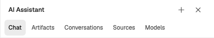
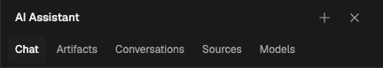
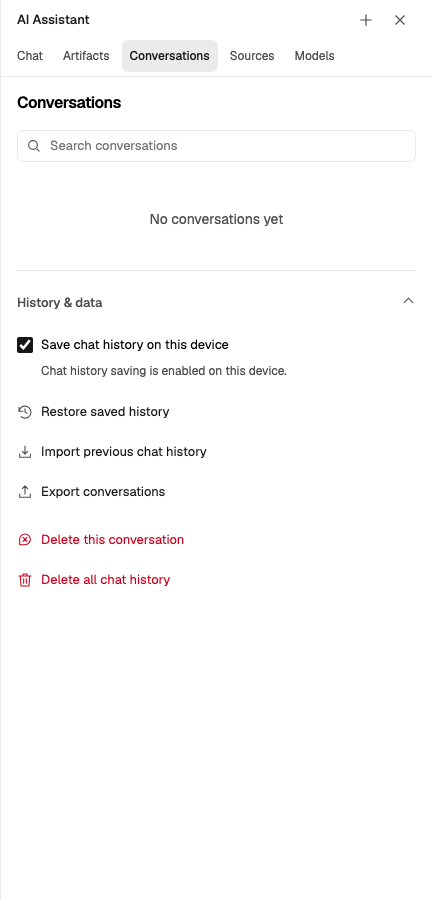
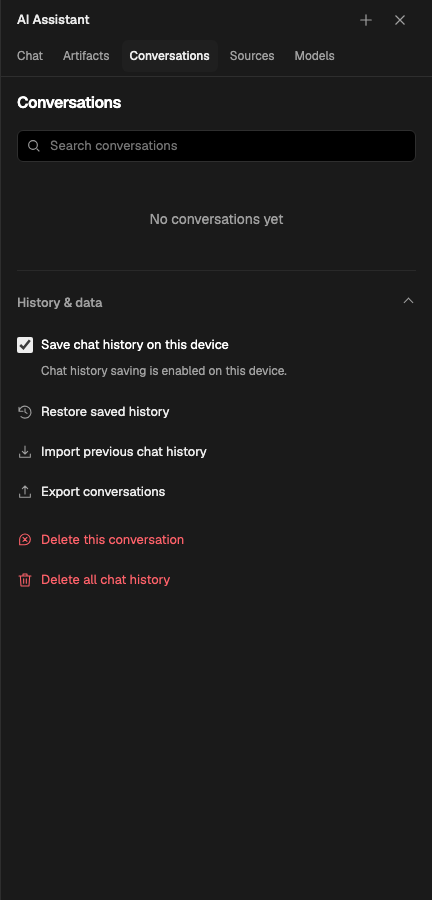
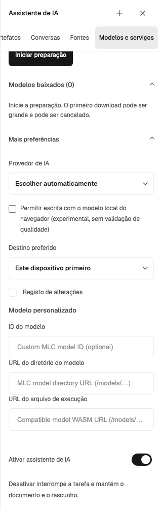
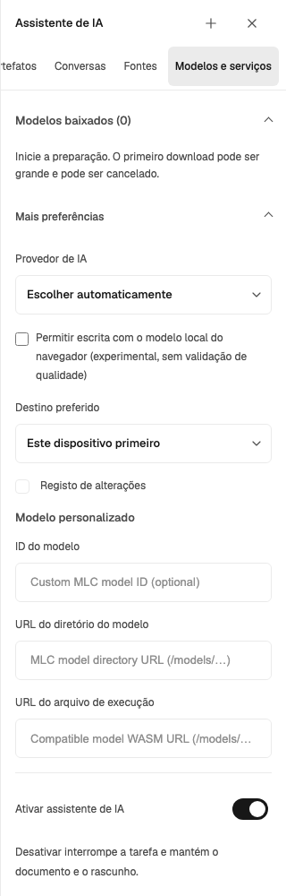

# Assistant header and visible-content alignment

Date: 2026-10-21

Header/alignment figures below record `681e4f9`. The expanded-workflow follow-up at the end
records the later spacing, target and focus corrections. These are scoped acceptance records,
not a claim that overall visual hierarchy or motion has reached a final design.

The previous header gave the assistant identity and every destination substantial visual weight.
History headings started at 16px, while the saving checkbox and command icons started at 24px.
Equal button frames therefore did not establish a shared leading-content spine.

## Result and ownership

The [application design contract](../design-system.md#assistant-header-and-settings-commands)
owns the current dimensions and control roles. Five named destinations remain directly available;
New, Close, nested artifact navigation, drafts and history state retain their existing owners.

| Measured relationship                                   | Before         | Current        |
| ------------------------------------------------------- | -------------- | -------------- |
| Fine-input title row / complete header and navigation   | 56 / 97px      | 40 / 77px      |
| Coarse-input title row / complete header and navigation | 60 / 113px     | 52 / 101px     |
| Heading, saving checkbox and command icon viewport      | 16 / 24 / 24px | 16 / 16 / 16px |
| Command label and associated saving status              | 48px           | 40px           |
| Command target height, fine / coarse input              | 32 / 44px      | 32 / 44px      |

Values are CSS pixels from the pane's inside border edge. The click surface uses 8px of the
existing gutter; the content spine remains 16px. History rows form a named command-list context
without repeated resting frames. Framed workflow actions and inputs retain their affordances.

The selected destination has a restrained fill distinct from the actual canvas in both themes,
with no curved inset underline. Current labels are medium weight; inactive navigation is regular.
Keyboard focus remains a separate blue outline. Palette properties do not animate on theme changes.

## Industry references

[Linear's 2026 refresh](https://linear.app/now/behind-the-latest-design-refresh) gives supporting
navigation less emphasis and makes tabs more compact while retaining predictable headers/actions.
[Cursor's side-chat and conversation-search update](https://cursor.com/changelog/side-chat)
keeps creation at the top of chat and provides a dedicated conversation-search route. These inform
hierarchy and placement; this application uses its existing ran roles and input-density contract.

## Actual browser evidence

The local current report contains 20 before/after pane pairs: Chat, Conversations, Artifacts,
Sources and Models in English desktop light/dark and Portuguese 320/360px coarse-input variants.
Four additional screenshots include browser-rendered alignment guides. The red guide marks 16px;
the blue guide marks the 40px history label/status column only within that control group.

The before pairs isolate header/alignment changes after the initial tab-underline removal. The
[previous acceptance record](./2026-10-21-assistant-navigation-and-density-acceptance.md) retains
screenshots of the earlier implementation, including the original selected underline.

| Light header                                                                                                        | Dark header                                                                                                       |
| ------------------------------------------------------------------------------------------------------------------- | ----------------------------------------------------------------------------------------------------------------- |
|  |  |

| Light history                                                                                                                                | Dark history                                                                                                                                  |
| -------------------------------------------------------------------------------------------------------------------------------------------- | --------------------------------------------------------------------------------------------------------------------------------------------- |
|  |  |

[320px touch alignment guides](../media/assistant-refinement/history-guides-pt-light-320.png),
[360px dark touch pane](../media/assistant-refinement/history-pt-dark-360.png),
[Chat](../media/assistant-refinement/chat-en-light-1280.png),
[Artifacts](../media/assistant-refinement/artifacts-en-light-1280.png),
[Sources](../media/assistant-refinement/sources-en-light-1280.png), and
[Models](../media/assistant-refinement/models-en-light-1280.png) show the same current chrome.
Representative [before history](../media/assistant-refinement/before-history-en-light-1280.png)
and [before Chat](../media/assistant-refinement/before-chat-en-light-1280.png) are retained.
[Measured history variants](../media/assistant-refinement/measurements.json) record the actual
coordinates and header heights, including the effective theme and selected fill.

## Header verification at `681e4f9`

- The independent page spine is 16px. Before the CSS correction, the cross-region assertion
  failed with the command icon at 24px. It no longer accepts equal but separately inset groups.
- Chromium: 14 navigation, layout-rail and history-action cases passed, retries disabled. Covers
  wrapping, resize, hover/press/disabled, contrast, accessible names, focus/confirmation, export,
  touch targets and rejection/restoration of deliberate geometry defects.
- WebKit: all four navigation/craft variants passed, retries disabled, including 320/360px touch.
- Selected fill and shadow are checked after moving the pointer away. Hover cannot supply the
  selected affordance being verified. The fill must differ from the actual pane canvas.
- Transparent history rows use the actual pane background for text-contrast measurement;
  hover/pressed rows use their painted surface. Deletion and focus checks remain in place.
- The design-token contract and changed-file formatting passed. The production preview was
  rebuilt from the changed styles; screenshots use that build, not temporary product overrides.

One intermediate run timed out while waiting for the native editor to become ready during
concurrent screenshot capture. The subsequent complete serial run passed 14/14 with no retries,
timeout increases or weakened tolerances. Firefox, native browser zoom and real model downloads
are not claimed as verified by this focused UI correction.

## Expanded-workflow follow-up

Actual production-browser inspection found attachment helper gap 0, model helper gap 17
(including inline-host baseline space), helper/action gap 12 and adjacent custom-field gap 0.
The corrected relationships are 8/8/16/16. Artifact confirmation actions now retain 8px separation.
Touch Chat starters measured 34.25px and now use the adaptive 44px target role. Source filename
and Remove text centers differed by 6.58px; their shared label role and density-derived first-line
padding now align without translating glyphs or changing the expanded excerpt's position.

Keyboard removal moves to the next/previous visible source action or Attach when the filtered
list is empty. Artifact confirmation focuses Cancel and cancellation returns to Delete, keeping
the draft. A long artifact case verifies that the safe choice is inside the narrow viewport.
These owners belong to document; no ran component-internal defect was established.

| Before custom fields                                                                                                                                           | Corrected custom fields                                                                                                                                       |
| -------------------------------------------------------------------------------------------------------------------------------------------------------------- | ------------------------------------------------------------------------------------------------------------------------------------------------------------- |
|  |  |

[Sources after correction](../media/assistant-detail-audit/source-excerpt-pt-360-touch-dark.png),
[Models in dark theme](../media/assistant-detail-audit/models-dark.png),
[touch Chat targets](../media/assistant-detail-audit/chat-pt-320-touch-light.png),
[artifact confirmation](../media/assistant-detail-audit/artifact-delete-confirmation-pt-320-touch-light.png),
and [focus return after cancellation](../media/assistant-detail-audit/artifact-delete-cancelled-pt-320-touch-light.png)
are representative full-pane renders. [Capture measurements](../media/assistant-detail-audit/captures.json)
list 68 current states across English desktop light/dark and Portuguese 320/360px coarse variants.
The local report retains 60 before/after pairs and 8 additional keyboard-focus captures.

The new regressions failed before their fixes: two focus unit cases; browser helper/focus cases;
confirmation gap 0vs8; touch targets 34.25 vs 44 and filename/Remove center drift 6.58 vs 1px tolerance.
Existing geometry expectations, retries and timeouts were not weakened. Final verification:
Chromium 31/31; WebKit 4/4 focused detail cases; unit 41/41; production build, TypeScript,
archive-aware lint, changed-file format and diff checks. See `agent-detail-polish.spec.ts` for
rendered spacing, physical targets and keyboard continuation; existing workspace/layout/source
and affordance suites remain in the run.

Overall hierarchy still needs design work: the five persistent destinations give configuration,
content and history similar prominence, and artifact commands need a tighter relationship to their
content. Current animation is limited; these static captures disable animation for geometry and
are not motion acceptance. Native zoom, system text scaling, screen readers and real model
downloads are outside this focused verification.
