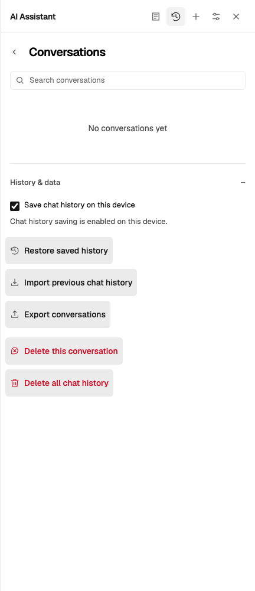
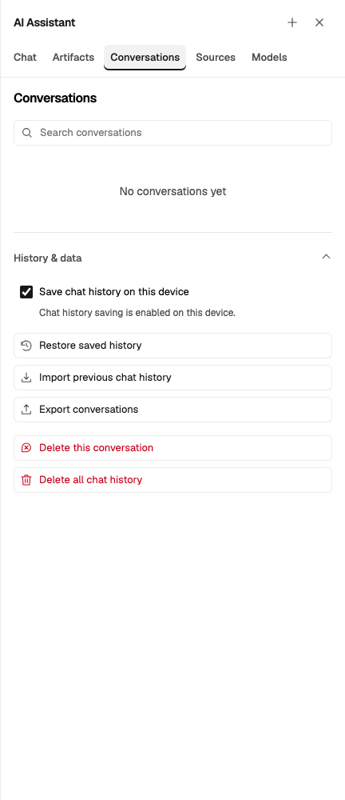
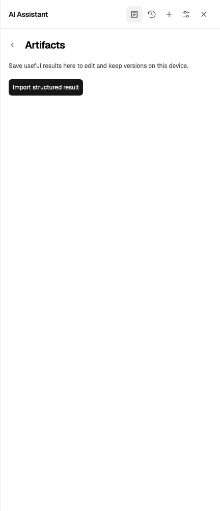
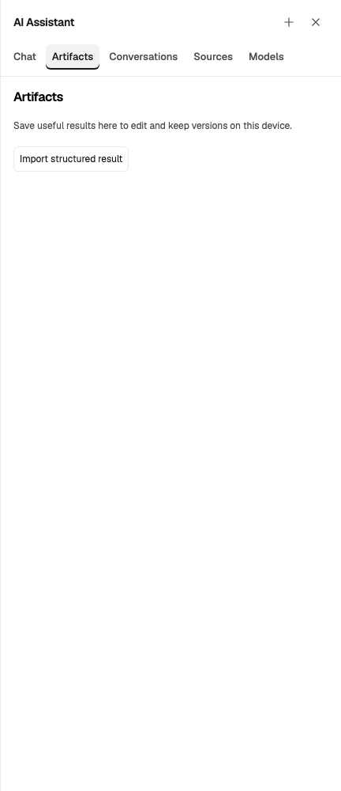

# Assistant navigation and density acceptance

Date: 2026-10-21

## Decision and scope

Owner review rejected the previous History & data button cloud and the artificial
Back/title hierarchy in Artifacts. This revision supersedes the 48/54px top-level
heading lane, content-sized history commands and gutter extension described in the
October 20 records. Passing the earlier geometry assertions did not establish
that the complete composition was acceptable.

The implementation follows [ran's design guide](https://github.com/chaxus/ran/blob/main/packages/ranui/docs/DESIGN.md).
[Linear's UI refresh](https://linear.app/changelog/2026-03-12-ui-refresh) and
[Notion's navigation](https://www.notion.com/help/navigate-with-the-sidebar) informed
stable parallel destinations and compact hierarchy. Colors, typography, spacing,
control roles and motion remain owned by ran and this application's design contract.

The original PR #289 merged while this revision was being verified. The correction
therefore ships as a follow-up PR rather than republishing the deleted branch.

## Actual rendered changes

| Surface           | Accepted composition                                                                                                          |
| ----------------- | ----------------------------------------------------------------------------------------------------------------------------- |
| Header/navigation | AI Assistant, New and Close; five persistent text destinations beneath it; selected and keyboard-focus states                 |
| Top-level views   | All heading text starts at 16px; no Back to an unrelated parallel destination                                                 |
| Nested artifacts  | A labeled Back precedes the heading; import/edit, unsaved drafts and confirmation remain owned by the artifact view           |
| History commands  | Equal-width frames at 16px; checkbox/icon column at 24px and label/status column at 48px; neutral resting stroke              |
| Density           | 32px fine-input command minimum; 44px coarse-input navigation, checkbox-label and command targets; translated labels can wrap |
| Command hierarchy | Import/Attach are secondary; reviewed Save/Accept remains primary; destructive commitment retains explicit confirmation       |
| Runtime status    | Chat or active Models loading owns it; no unrelated preparation band above Artifacts or Sources                               |
| Details           | Blue keyboard focus, disclosure chevron, 150ms opacity entry and reduced-motion opt-out; no translated hit targets or blur    |

Before and after, captured in the same actual browser at a 1280px window / 432px pane:

| Before                                                                                         | After                                                                                            |
| ---------------------------------------------------------------------------------------------- | ------------------------------------------------------------------------------------------------ |
|   |               |
|  |  |

## Screenshot inspection

The final production build was captured in 72 full-pane PNGs: 17 states in English
light/dark desktop and Portuguese 320px-light/360px-dark coarse-input variants.
Four additional German/Spanish coarse-input captures check the localized current-Chat label
and selected-navigation visibility. The 17 main-matrix states include Chat, expanded History, confirmation, empty/populated Artifacts,
import, editor, local/expanded/service Models, empty/populated/expanded/error Sources
and resized History/Sources. The narrow states explicitly resize the window to 360px.
Screenshots use local synthetic text and no real provider credentials or inference.

Main-agent inspection and independent visual review found no remaining alignment,
clipping, overlap, focus-boundary or control-hierarchy blockers in the reviewed
representative states. Inspection prompted correction of import hint density,
coarse navigation targets and the inset navigation focus outline before these final captures.
This is visual acceptance of the inspected states, not a general usability study.

Additional final renders:

| State                                         | Real capture                                                                  |
| --------------------------------------------- | ----------------------------------------------------------------------------- |
| History, dark                                 | [PNG](../media/assistant-craft/2026-10-21-history-dark.png)                   |
| Destructive confirmation, dark                | [PNG](../media/assistant-craft/2026-10-21-history-confirmation-dark.png)      |
| Portuguese 320px touch History                | [PNG](../media/assistant-craft/2026-10-21-history-pt-320-touch-light.png)     |
| Artifacts, dark                               | [PNG](../media/assistant-craft/2026-10-21-artifacts-dark.png)                 |
| Nested import and visible keyboard focus      | [PNG](../media/assistant-craft/2026-10-21-artifact-import-light.png)          |
| Nested editor, dark                           | [PNG](../media/assistant-craft/2026-10-21-artifact-editor-dark.png)           |
| Local model setup                             | [PNG](../media/assistant-craft/2026-10-21-models-light.png)                   |
| Service model setup, dark                     | [PNG](../media/assistant-craft/2026-10-21-models-service-dark.png)            |
| Attached source                               | [PNG](../media/assistant-craft/2026-10-21-sources-populated-light.png)        |
| German 320px touch current-Chat navigation    | [PNG](../media/assistant-craft/2026-10-21-chat-de-320-touch-light.png)        |
| Spanish 360px touch History, dark             | [PNG](../media/assistant-craft/2026-10-21-history-es-360-touch-dark.png)      |
| Portuguese 360px touch attachment error, dark | [PNG](../media/assistant-craft/2026-10-21-source-error-pt-360-touch-dark.png) |

## Behavior fixes and verification

Persistent destination selection is idempotent. It neither acts as Back nor refreshes
an already active form. A first-mount flag still runs initial visibility/ARIA setup.
Explicit Chat returns to the displayed conversation and draft. Header and navigation
intent also invalidate the initial asynchronous cache-discovery fallback, preventing
it from switching an explicitly selected Chat back to Models. New conversation and
title/recent-session behavior retain their separate existing semantics.

Artifact refresh now respects an in-flight operation, including after an awaited
list response, so a workspace refresh cannot replace the import/editor while saving.
Owned delete/missing-record refresh remains available. Controlled async unit
regressions first exposed these failures and passed after the fixes.

| Check                                        | Observed result                                                                                                                                                                                                               |
| -------------------------------------------- | ----------------------------------------------------------------------------------------------------------------------------------------------------------------------------------------------------------------------------- |
| Full final unit suite                        | 252 files, 6,807 tests passed                                                                                                                                                                                                 |
| Focused final unit suites                    | 8 files, 360 tests passed                                                                                                                                                                                                     |
| Chromium navigation craft matrix             | 4 passed, retries disabled                                                                                                                                                                                                    |
| Broad Chromium assistant regression          | 85 cases: initially 79 passed, 3 skipped, 3 failed; final targeted rerun passed all 4 selected cases including the 3 failures                                                                                                 |
| WebKit history/layout/craft                  | 14 passed serially with retries disabled                                                                                                                                                                                      |
| Firefox history/layout/craft                 | All 14 stopped at browser launch: `Could not find profile folder`; independent empty-browser launch reproduced it before visiting the app                                                                                     |
| Lint/typecheck, formatting, production build | Passed; immutable archive verification retained all 1,511 evaluation artifacts                                                                                                                                                |
| Deliberate geometry mutations                | Existing layout suite rejects shifted text, expanded title hit area and displaced sibling rails; a final live probe also rejected an 8px label-only shift with identical button bounds and passed after removing the mutation |
| Motion probe                                 | Actual computed animation `agent-view-enter`, `0.15s`, transform `none`; reduced motion gives animation `none`, `0s`                                                                                                          |

The first full unit run caught two untranslated current-Chat labels. German and Spanish
labels were corrected without changing the translation-completeness test or its allowlist;
the complete 252-file rerun then passed.

A final production-preview Chromium run of content review, translated loading, PDF native
contracts and the four craft variants passed all 18 cases without retries. It retained native
readback, undo, PDF write restrictions and model-loading cancellation assertions.

The broad Chromium failures comprised the real initial-navigation race fixed above
and two tests navigating with the superseded same-destination toggle contract. Those
tests now use explicit Chat/Sources navigation while retaining their source, dirty-draft,
request, offline and cancellation assertions. They do not merely accept a new screenshot.
The three skipped cases require unavailable public legacy-format corpus fixtures.
The table reports separate runs, not one entirely green 85-case rerun.

An earlier concurrent WebKit attempt emitted `WebGL: context lost`; the isolated
14-case run passed without changing the console allowlist or application code.
Firefox remains unverified in this environment; its launch failure is not counted
as an application pass. The production build was completed before final capture;
no rebuild ran while that browser acceptance was reading its assets.

Native browser zoom, the full repository/Docker suite, actual model downloads and
real external AI service calls were not verified by this focused revision. No
vendor files, dependency versions, persistence formats or document-write contracts changed.
