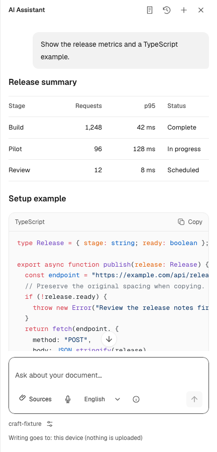

# Assistant return and Markdown correction acceptance

Accepted runtime: `bd0e8c146bbde9b55a53ba04db1d95ff60affcd9`.
Build SHA-256: `89f8d8bf62aaa8d1f594cad6fedbb3e9bc6c4d26ced2674b58dc0e21af58395d`.
The earlier
[visual approval](2026-10-21-assistant-conversation-craft.md) is withdrawn: it
missed duplicate return controls and an 8px visible command-text offset. The
original media remains historical evidence.

## Corrected behavior

The shell hosts the actual guarded artifact Back button. Detail and import
return to the artifact list; the list returns to Chat. Escape follows the same
hierarchy even from peer header controls. Dirty confirmation, safe Cancel,
pending-save protection and restored focus/draft selection retain their owners.
The compact visible destination remains readable on 320px touch panes and is
included in its localized accessible name. Command text follows the 16px spine.

Chat and artifact readers use the same safe table/code presentation. Tables
honor declared column alignment, use regular body weight and tabular numbers,
and scroll wide content locally. Ordinary four-column tables fit the desktop
pane. Code has a compact language/Copy header, exact literal clipboard payload,
real success/failure feedback and local horizontal scrolling. Supported completed
blocks up to 8000 characters load fixed Shiki grammars and dual-theme token
colors lazily; unknown/unfinished blocks remain plain. No execution action is
implied. Completed nested code keeps selection, scroll and DOM identity when a
stream settles. Disposal guards late clipboard/highlight work.

## Actual acceptance

The final build produced 92 original pane screenshots and 8 continuous recordings
(about 18 seconds each). Root and independent review inspected all 8 state sheets,
all 8 decoded recording sheets and critical full-size originals. No blocking
composition or legibility defect remained. Representative [original panes,
recordings and provenance](../media/assistant-craft-correction/) are committed;
the complete inventory and full-browser originals remain in the local report.
The environments are desktop English light/dark and Portuguese touch at 320px
light / 360px dark. Dark variants request reduced motion. The deterministic
provider fixture supplies public NDJSON only; no product CSS or DOM is injected.

## Verification

- 6,915 unit tests in 258 files passed with unchanged coverage thresholds: 90.54%
  lines, 88.16% statements, 84.24% branches and 89.02% functions.
- 38 distinct related browser cases verified:33 initial passes, 2 corrected visible-route
  cases, and 3 reasoning/touch cases. No retries or overflow tolerance changes.
- Archive-aware lint, root/workspace TypeScript, Prettier and 1511 immutable evaluation
  artifact checks passed. The production build identity is recorded above.
- Local report QA at 1280px and 320px decoded 94 displayed images and 8 recordings,
  with zero horizontal overflow or JavaScript errors.
- Spec, code and actual screenshot/decoded-recording review passed. Remote CI
  follows the approved push and is recorded by the PR checks/local report.

No thresholds or overflow tolerances were relaxed. The existing Stop regression still checks raw source, deferred parsing,
focus, draft preservation and disposal; only its renderer-call signature now
includes the explicit presentation owner.

## Design references and limits

The adopted reading hierarchy is informed by [Geist Table](https://vercel.com/geist/table),
[Geist Code Block](https://vercel.com/geist/code-block),
[AI Elements Code Block](https://elements.ai-sdk.dev/components/code-block),
and [ChatGPT's public code-block guidance](https://help.openai.com/en/articles/20001246-working-with-writing-blocks-and-code-blocks-in-chatgpt).
These references establish concrete presentation patterns, not competitor parity.

The fixture proves UI behavior, not model answer quality. Native Word insertion
still has its documented Markdown-table limit. Changing a still-growing unfinished
fence retains the existing streaming renderer behavior; selection preservation
covers completed/reused blocks and late highlighting. ran's existing reasoning
and agent-guidance changes remain in [ran#436](https://github.com/chaxus/ran/pull/436);
this correction belongs to the application's renderer and composition. No package
publication or merge is included.
