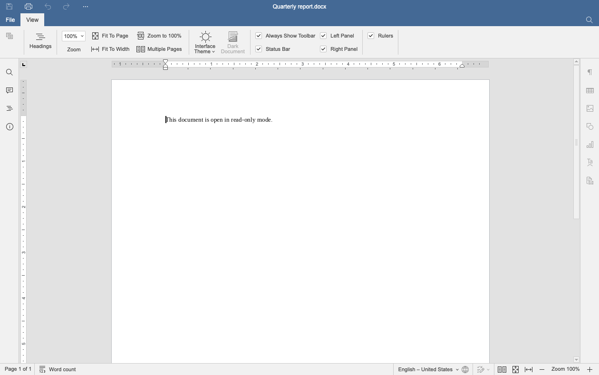
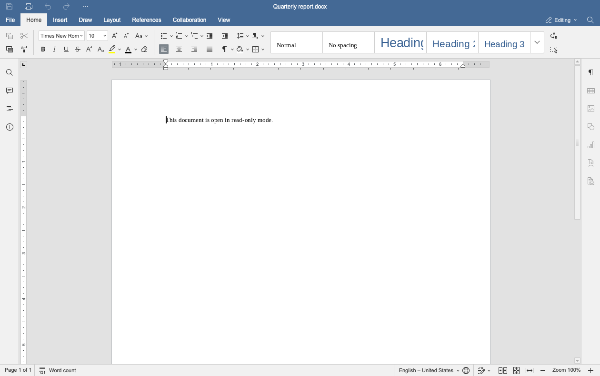
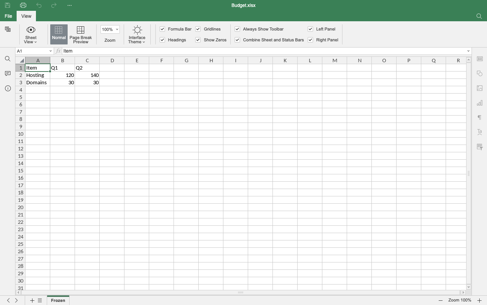
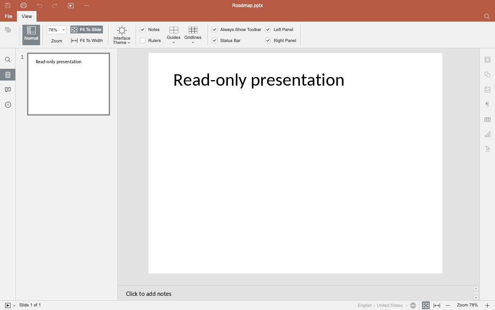
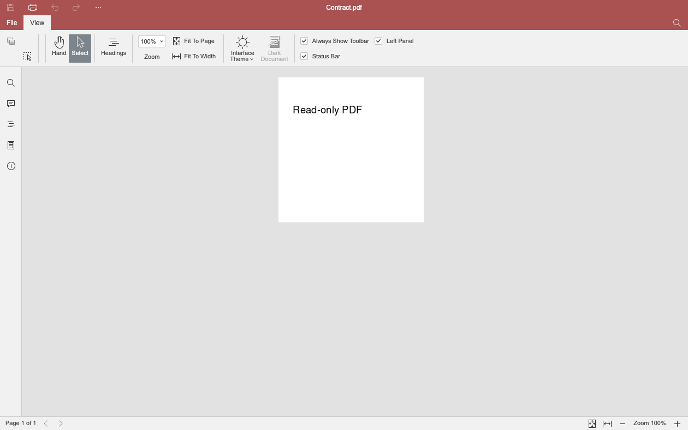

# 只读模式下工具栏看起来仍可编辑（#298）

> 后续：工具栏遮罩已改为隐藏编辑页签与按钮，见 [2026-11-02-readonly-hide-edit-tabs.md](2026-11-02-readonly-hide-edit-tabs.md)。

## 现象

以只读打开文档（`?readonly=1`，或 embed 的 `readonly: true` / `document:set-readonly`）后，
编辑确实被拦住了：加粗、输入都没有效果。但工具栏、右侧面板、右键菜单的外观和可编辑时完全
一样，用户只会觉得"按钮坏了"。2026-11-02 在线上 `/embed-demo` 用示例 xlsx 复现。

## 根因

1. 只读走的是 `asc_setRestriction(128)`（`lib/onlyoffice/readonly.ts`）。它只在 SDK 层拦修改。
   SDK 改完会发 `asc_onChangeRestrictions`，但 vendor 里只有插件框架订阅它，
   四个 web-apps（word / cell / slide / pdf）的界面一个都没听，所以 UI 不知道。
2. `readonly.ts` 里那条 `processRightsChange` "回退"从来没发出去：`editorSendCommand` 调的是
   DocEditor 的 `serviceCommand`，它把命令包进 `internalCommand`
   （`public/web-apps/apps/api/documents/api.js` 的 `_serviceCommand`），编辑器不认。
   就算发出去也不能用：vendor 处理它的方式是 `asc_coAuthoringDisconnect()`，断开之后回不来，
   正是这套"运行时可逆只读"要避开的那扇单向门。

## 修法

不改挂载方式（仍是 edit 挂载 + restriction，运行时双向切换）。在设置/解除 restriction 的同时，
向编辑器 frame 触发 vendor 自己的 `Common.NotificationCenter.trigger('editing:disable', 开关, options, 'readonly')`。
这是 vendor 用来处理签名、表单、断线的同一套机制，**按 type 入栈**：解锁时只弹出自己这一层，
弹完会把栈顶剩下的那层重新应用，不会误开别人锁住的东西。

- options 一个对象四个编辑器通用（各自只读自己认识的键）：锁工具栏、右侧面板、右键菜单、
  修订、评论/左侧栏进入预览、单元格编辑栏预览、顶栏编辑模式切换（`header.docmode`）。
  **不锁**：左侧搜索与导航、顶栏搜索、状态栏（缩放和工作表页签在里面）、快捷键（复制、查找）。
- **`viewMode` 必须跟着开关走**：`DisableToolbar(disable, viewMode)` 会把它存成
  `this.editMode = !viewMode`，解锁时若仍传 `true`，`disable || !editMode` 恒为真，遮罩永远不掉。
  vendor 自己的签名流程也是传 `viewMode: disable`。
- 每个 frame 记一个 `__readonlyChrome`，没锁过就不发解锁，避免在正常状态上跑一遍 vendor 的重新启用路径。
- `onDocumentReady` 原来只补 restriction，现在改成调 `setReadonlyMode(true)`，界面和 restriction 一起上。
- 删掉 `processRightsChange` 回退和 `editorSendCommand`（`rg` 确认零引用），以及钉住这条死路径的两条单测。

## 取舍

遮罩是整条工具栏一起盖。PDF 编辑器 Home 页签上本来就有翻页、缩放、抓手工具，它们也被盖住了；
底部状态栏的缩放、适应页面/宽度、翻页与左侧搜索/导航/缩略图仍然可用。

## 验证

- 新增 `test/e2e/readonly-chrome.spec.ts`：docx / xlsx / pptx / pdf 各一条，只读打开 →
  `#toolbar .toolbar-mask` 存在且左侧搜索、放大按钮可用 → 运行时解锁 → 遮罩消失 → 再锁 → 遮罩回来。
- **反向验证**：注释掉 `syncReadonlyChrome(readonly)` 后 4 条全红（`masked: false`），恢复后全绿。
- 已有的只读相关用例（format-parity、embed-regression、pdf-roundtrip）与新用例合计 13 条全过
  （本地 vite dev）。
- `vendor-contract.test.ts` 新增：四个 app.js 仍订阅 `editing:disable`、仍有 `stackDisableActions`、
  `DisableToolbar` 仍把 viewMode 存成 editMode。vendor 升级改了这些会先红。

## 截图（#300 之后的最终效果）

2026-11-02 在 #300 的 Cloudflare Pages 预览部署上用 `/embed-demo` 拍摄，编辑器区域 1260×789。

| 状态          | 截图                                                |
| ------------- | --------------------------------------------------- |
| docx 只读     |    |
| docx 解锁之后 |  |
| xlsx 只读     |    |
| pptx 只读     |    |
| pdf 只读      |      |
