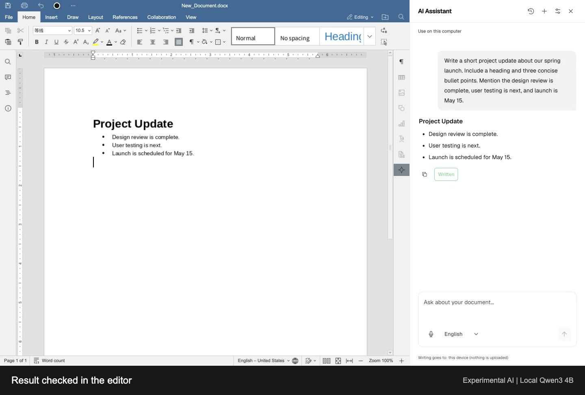
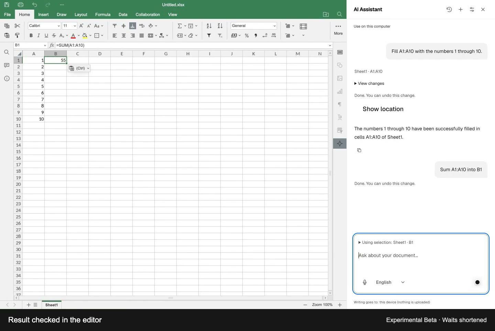
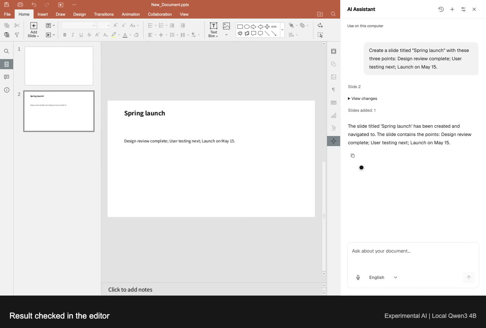
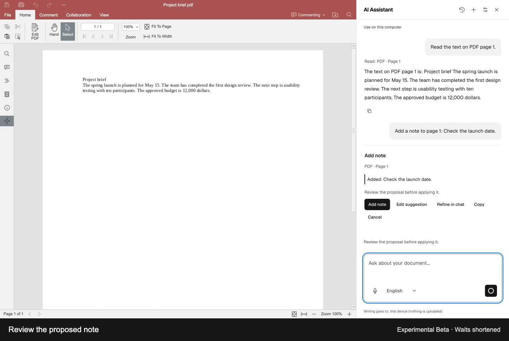

# Online Document Editor

<p align="center">
  <a href="https://github.com/ranuts/document/actions/workflows/ci.yml">
    
  </a>
  <a href="https://github.com/ranuts/document/blob/main/LICENSE">
    
  </a>
  <a href="https://github.com/ranuts/document/releases">
    
  </a>
  <a href="https://edit.chaxus.com/">
    
  </a>
</p>

<p align="center">
  <b>English</b> |
  <a href="readme.zh.md">简体中文</a> |
  <a href="readme.ja.md">日本語</a> |
  <a href="readme.ko.md">한국어</a> |
  <a href="readme.de.md">Deutsch</a> |
  <a href="readme.es.md">Español</a> |
  <a href="readme.pt.md">Português</a> |
  <a href="readme.fa.md">فارسی</a>
</p>

**An open source document workspace for you and your AI agents.**

Open, edit, convert and save Word, Excel and PowerPoint files, and annotate PDFs in your browser. Core document processing runs locally, with no account or Office installation required.

Use optional AI assistance (Experimental Beta), let browser agents call document tools through WebMCP, or install it as a PWA. Cached editor resources work offline; you can also self-host or embed the editor in your app.

**Try it online: [edit.chaxus.com](https://edit.chaxus.com/)**

---

## ✨ Features

- **Edit locally.** Open, edit and convert documents on your device, without a required document upload.
- **Save your way.** Write back to your chosen file where supported, or download an export. Reopen recent work from this browser.
- **Work with AI (Experimental Beta).** Draft and refine text, work with spreadsheet data, create slides or ask about the current PDF page. Review changes before applying them.
- **Let agents handle documents.** In [WebMCP](docs/reference.md#webmcp-agent-tools)-compatible browsers, AI agents can open, convert and export files, and read text from word-processing documents.
- **Install as a PWA.** Use it as an app; cached editor resources can work offline.
- **Host or embed it.** Self-host a static site or add the editor to your app through its iframe API.

## 🚀 Quick start

[New document](https://edit.chaxus.com/editor?new=docx&locale=en) · [New spreadsheet](https://edit.chaxus.com/editor?new=xlsx&locale=en) · [New presentation](https://edit.chaxus.com/editor?new=pptx&locale=en)

Or run your own copy:

```bash
docker run -d --name document -p 8080:80 ghcr.io/ranuts/document:latest
```

## 📄 Formats

| Kind          | Edit                   | Also opens                  |
| ------------- | ---------------------- | --------------------------- |
| Documents     | `.docx`                | `.doc` `.odt` `.rtf` `.txt` |
| Spreadsheets  | `.xlsx` `.csv`         | `.xls` `.ods`               |
| Presentations | `.pptx`                | `.ppt` `.odp`               |
| PDF           | annotate, fill, export | `.pdf`                      |

Export supported documents to PDF.

Multilingual interfaces, light and dark themes, and read-only preview are also supported.

## 🔐 Local editing and data handling

Recovery copies stay in this browser for 7 days after the last edit or open. Delete them in [Saved documents](https://edit.chaxus.com/history). Export anything you want to keep; recovery is not a backup.

Optional AI services receive the content needed for your request. On-device models keep it local. Browser dictation may use an online speech service; embedded exports are handled by the host app.

Your chosen browser AI agent controls how it handles content returned by document tools.

## Documentation

[User guide](https://edit.chaxus.com/help) · [Self-hosting, URLs and integration](docs/reference.md) · [Embedding API](docs/embed-api.md) · [Fonts](docs/fonts.md)

Offline use needs cached editor assets; uncached resources and remote files still need a network.

## AI document assistant (Experimental Beta)

Draft and refine text, work with spreadsheet data, create slides or ask about the current PDF page. Review changes before applying and use Undo when needed.

Choose an on-device model or connect your own AI service. Dictate prompts where the browser supports speech input.

**Experimental Beta.** Off by default. Answers and edits can be wrong; check important results.

<details>
<summary>Watch the four demos</summary>

| Word                                                                                                                                                    | Excel                                                                                                                                                      |
| ------------------------------------------------------------------------------------------------------------------------------------------------------- | ---------------------------------------------------------------------------------------------------------------------------------------------------------- |
| [](https://github.com/user-attachments/assets/8d1d6386-e33a-45f2-b968-b8695c8f7da9) | [](https://github.com/user-attachments/assets/5bb253d7-3cc5-4f31-989e-0c88dcb1615c)     |
| **Draft, write, summarize and undo**                                                                                                                    | **Fill, calculate, sort and undo**                                                                                                                         |
| PowerPoint                                                                                                                                              | PDF                                                                                                                                                        |
| [](https://github.com/user-attachments/assets/db3fc7a7-b54e-4147-a7ca-e7f16243618e)       | [](https://github.com/user-attachments/assets/f01c2da6-0669-4111-87c1-c4440f4a60e9) |
| **Create, duplicate and undo**                                                                                                                          | **Read, ask questions and review notes**                                                                                                                   |

Complete workflows at normal speed, recorded in English with a loaded local Qwen3 4B model. Response times vary by model and device.

[Videos, captions and text descriptions](docs/media/ai-demos/README.md)

PDF assistance covers selectable text and page notes, not scanned-image text or rewriting PDF body text.

</details>

## 🛠 Development

Run from source:

```bash
git clone https://github.com/ranuts/document.git
cd document
pnpm install --frozen-lockfile
pnpm run dev
```

Feedback and contributions are welcome: [Issues](https://github.com/ranuts/document/issues) · [Pull requests](https://github.com/ranuts/document/pulls)

## 📚 Built on

- [sdkjs](https://github.com/ONLYOFFICE/sdkjs) and [web-apps](https://github.com/ONLYOFFICE/web-apps) — the OnlyOffice editors
- [onlyoffice-x2t-wasm](https://github.com/cryptpad/onlyoffice-x2t-wasm) — the WASM document converter
- [ranui / ranuts](https://github.com/chaxus/ran) — the design system and utilities this site is built with
- [se-office](https://github.com/Qihoo360/se-office), [onlyoffice-web-local](https://github.com/sweetwisdom/onlyoffice-web-local) — prior art for running OnlyOffice without a document server

## 📄 License

[AGPL-3.0](LICENSE) · [NOTICE](NOTICE)

<details>
<summary>Upstream notices and trademarks</summary>

This project is a modified version of the ONLYOFFICE editors (sdkjs and web-apps,
copyright Ascensio System SIA). Its interface uses neutral descriptions without
product logos or promotional branding. Copyright, license, modification and
source information remain available in the editor's About pane and in
[NOTICE](NOTICE). Third-party GUI assets and fonts retain their respective
licenses; removing product marks does not change those licenses.

The decision to omit product logos follows the FSF's published interpretation
of AGPLv3 Section 7. It is not described as a court ruling or a guarantee of
legal compliance; the upstream position and the rationale are recorded in NOTICE.

ONLYOFFICE is a trademark of Ascensio System SIA. This project is not an official
ONLYOFFICE product and is not affiliated with, sponsored by or endorsed by
Ascensio System SIA. Names in legal notices and source references identify the
upstream technology, not this project's brand.

PWA installation and browser tabs use an independently drawn, neutral document
icon. It contains no upstream logo, trademark or project initials.

</details>
